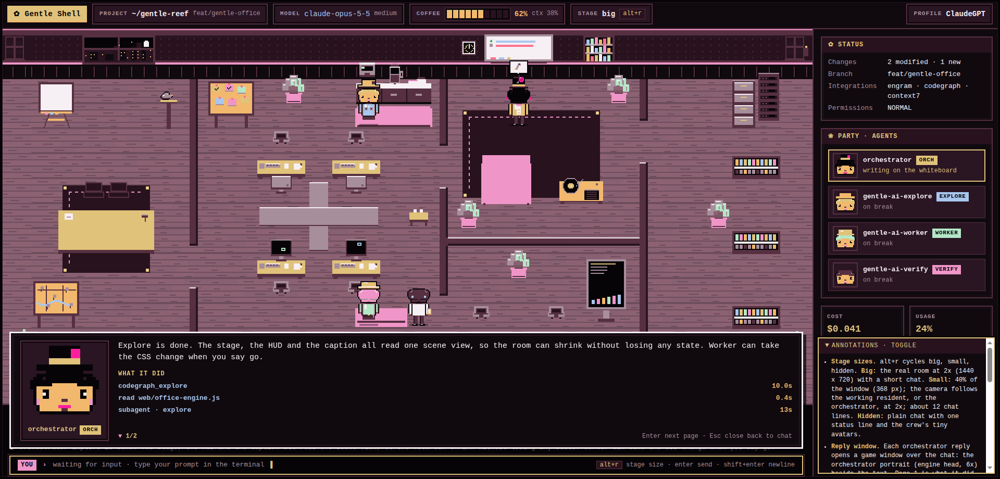

# Gentle Office (gentle-reef)

**Watch your coding agent work.** Gentle Office is a pixel-art office that shows what [gentle-shell](https://github.com/Gentleman-Programming/gentle-shell) is doing in real time: the orchestrator thinks at its whiteboard, subagents walk in and type at their desks, the context window drains like a coffee pot, and questions for you pop up as game dialogs.

It is a [Pi](https://github.com/earendil-works/pi) package. It reads the session's real events, so there is no fake data.


## Status

| Mode | How to start it | State |
| --- | --- | --- |
| **Web window** | `/office` inside any gentle-shell session | **MVP, usable today.** Three layouts, live events, local-only server. |
| **Terminal stage** | `gentle-reef` launcher | **Experimental.** The launcher works but only shows a one-line status widget. The full stage is designed ([preview](#terminal-mode-preview)) and still needs to be built. [Help wanted](CONTRIBUTING.md). |

## What you see

| | |
| --- | --- |
|  |  |
| **Story layout**: the camera follows whoever acted last, and a game text box narrates every event. | **Compact layout**: one narrow column for a side pane. |


- **The orchestrator** (top hat, monocle, pink mustache) rests in its armchair, walks to the whiteboard to think or run tools, and comes to the front with a `?` when it waits for you.
- **Subagents** (explore, worker, verify) sit at the 2x2 desk pod or in the verify lab. They type while they run and leave with `✓` or `!`.
- **The idle crew** chats and drinks coffee in the lounge until a subagent with their role starts.
- **The coffee pot** is your context window. Compaction brews a fresh pot.
- **Props** light up while their tool runs: the filing cabinet for memory, the pigeon for web search, the easel for design, and the corkboard for todos.
- **`ask_user` prompts** appear as a dialog. It only displays the question: you still answer in the terminal.

## Quick start

You need [Pi](https://github.com/earendil-works/pi) with gentle-shell, and Node.js 22.18 or newer.

```bash
pi install git:github.com/maiconcrespo/gentle-reef
```

Then, inside a gentle-shell session:

```text
/office          # menu: turn on/off, open a layout, status
/office on       # start listening in this session
/office open     # open the full layout in your browser
/office story    # or the story layout
/office dock     # or the compact layout
```

The window is served on `127.0.0.1` behind a random token, accepts GET only, and loads no external resources. Every session decides for itself, and nothing is written to disk.

### Terminal mode (experimental)

```bash
ln -s "$PWD/bin/gentle-reef" ~/.local/bin/gentle-reef   # from a checkout
gentle-reef                                             # gentle-shell with the office attached
```

## Terminal mode preview

This is the target design for the terminal stage (`design/terminal-office/02-stage-over-chat.html`). It uses the same engine, drawn in Ghostty through the Kitty graphics protocol. `alt+r` cycles the stage between big, small and hidden, and each reply opens a game window with the speaker's portrait.



## Roadmap

- [x] Event contract, adapter, hub and the local window server
- [x] Web office: full, compact and story layouts, narration, idle crew, props, ask dialog
- [x] `gentle-reef` launcher and per-session modes
- [ ] **Terminal stage** built from the design (T7). This is the next milestone.
- [ ] Review inspectors that visit during native review (T4)
- [ ] Judgment-day judges debating at their table (T5)
- [ ] A boss character you move with the keyboard, which sends prompts over an authenticated channel (T8, security-sensitive)
- [ ] Music radio tied to gentle-shell music

## Contributing

Contributions are welcome, from sprites to the terminal stage. Read [CONTRIBUTING.md](CONTRIBUTING.md) first. The full behavior is documented in [docs/reference.md](docs/reference.md).

## License

[MIT](LICENSE)
