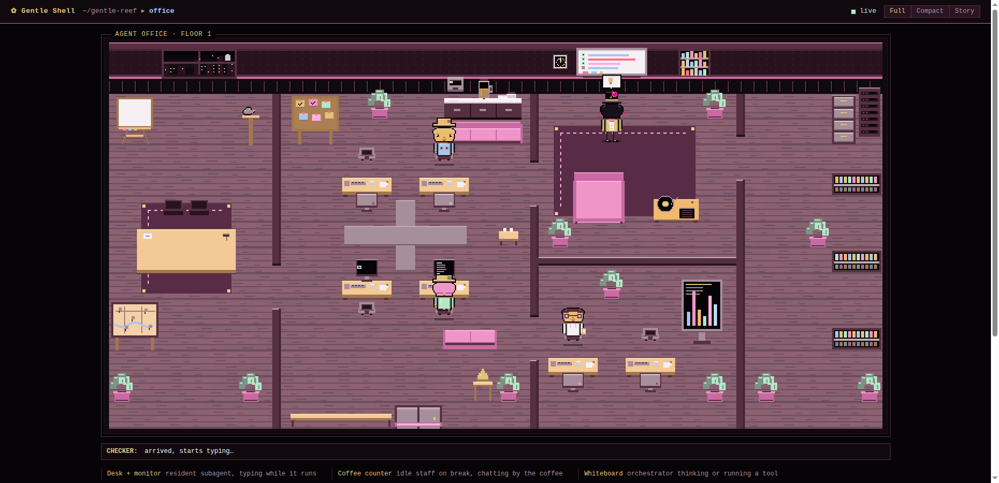
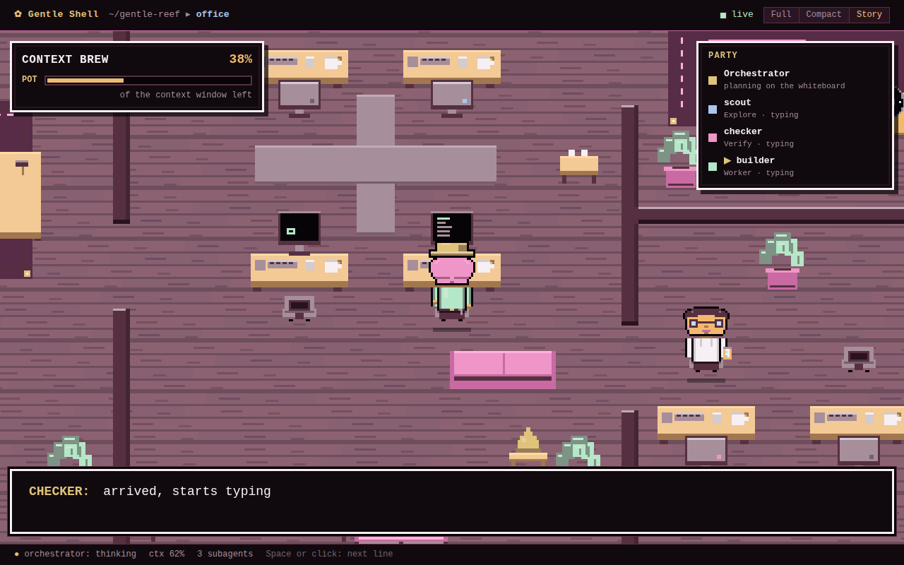
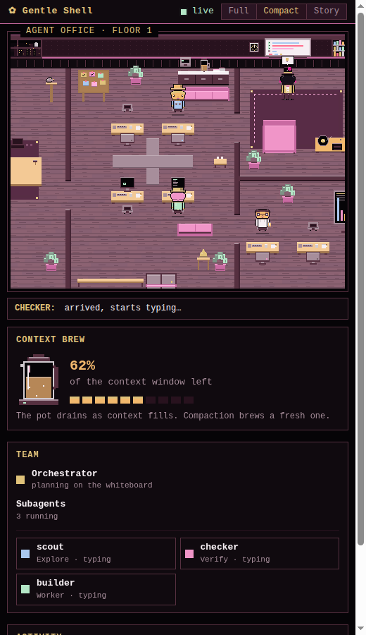
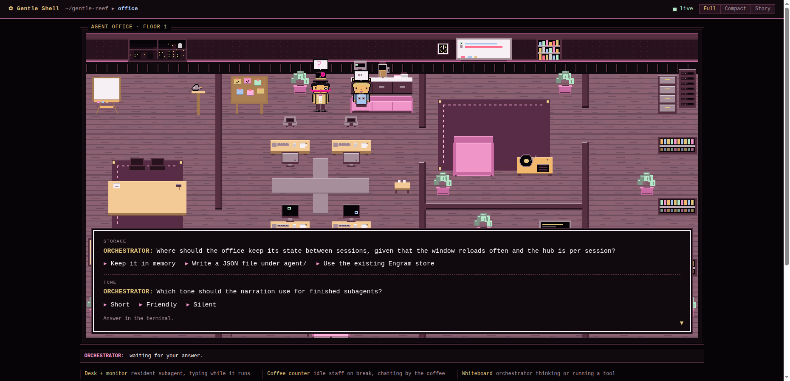
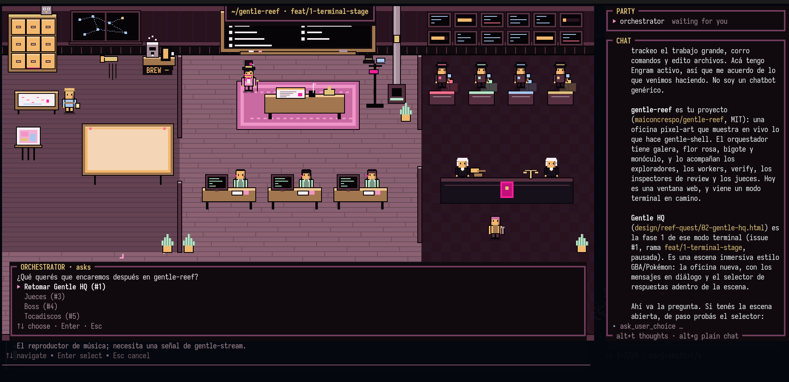

# Gentle Office (gentle-reef)

[](https://github.com/maiconcrespo/gentle-reef/actions/workflows/test.yml)

**Watch your coding agent work.** Gentle Office is a pixel-art office that shows what [gentle-shell](https://github.com/Gentleman-Programming/gentle-shell) is doing in real time: the orchestrator thinks at its whiteboard, subagents walk in and type at their desks, the context window drains like a coffee pot, and questions for you pop up as game dialogs.

It is a [Pi](https://github.com/earendil-works/pi) package. It reads the session's real events, so there is no fake data.



## Status

| Mode | How to start it | State |
| --- | --- | --- |
| **Web window** | `/office` inside any gentle-shell session | **MVP, usable today.** Three layouts, live events, local-only server. |
| **Terminal game mode** | `gentle-reef` launcher | **Preview.** The Gentle HQ office drawn over Pi's chat in terminals with Kitty graphics (Ghostty, Kitty), with the chat, live thinking and questions inside the scene ([see below](#terminal-game-mode)). Other terminals keep a one-line status widget. |

## What you see

| | |
| --- | --- |
|  |  |
| **Story layout**: the camera follows whoever acted last, and a game text box narrates every event. | **Compact layout**: one narrow column for a side pane. |



- **The orchestrator** (top hat, monocle, pink mustache) rests in its armchair, walks to the whiteboard to think or run tools, and comes to the front with a `?` when it waits for you.
- **Subagents** (explore, worker, verify) sit at the 2x2 desk pod or in the verify lab. They type while they run and leave with `✓` or `!`.
- **The idle crew** chats and drinks coffee in the lounge until a subagent with their role starts.
- **The coffee pot** is your context window. Compaction brews a fresh pot.
- **Props** light up while their tool runs: the filing cabinet for memory, the pigeon for web search, the easel for design, and the corkboard for todos.
- **`ask_user` prompts** appear as a dialog. It only displays the question: you still answer in the terminal.

## Quick start

You need [Pi](https://github.com/earendil-works/pi) with gentle-shell, and Node.js 22.18 or newer.

```bash
pi install git:github.com/maiconcrespo/gentle-reef
```

Then, inside a gentle-shell session:

```text
/office          # menu: turn on/off, open a layout, status
/office on       # start listening in this session
/office open     # open the full layout in your browser
/office story    # or the story layout
/office dock     # or the compact layout
```

The window is served on `127.0.0.1` behind a random token, accepts GET only, and loads no external resources. Every session decides for itself, and nothing is written to disk.

### Terminal game mode (preview)

```bash
ln -s "$PWD/bin/gentle-reef" ~/.local/bin/gentle-reef   # from a checkout
gentle-reef                                             # gentle-shell with the office over the chat
```

## Terminal game mode



`gentle-reef` draws **Gentle HQ** (design: `design/reef-quest/02-gentle-hq.html`) over Pi's chat, as one Kitty image plus terminal text. The editor stays at the bottom and keeps the focus, so you type as usual.

- **The room**: every object is a gentle-shell feature, and the crew shows who is doing what. The orchestrator in its pink suit works at the monitor on its desk while it thinks or runs a tool, and rests behind the desk while it waits; you are the Boss, in front of its desk while it works and by the door when all is still. Writers code at their drafting desks while they run, their screens hold a still game when idle, and after three minutes without work they take a coffee break. A black chalkboard marks the ODD steps. In the review wing each 4R lens desk lights its magnifier while its lens inspects and shows a green check when the review approves, the two judges debate in turns during a Judgment Day and strike the gavel when they finish, and the verify lab sits below. It animates at 4 fps only while someone acts.
- **Signs in the scene**: a framed sign with the project and branch hangs over the chalkboard, `BREW nn%` (the context left) sits under the coffee corner by the window, and a pink `✿ GENTLE HQ` plaque sits under the door.
- **Notices, Doing now and the monitor wall**: warnings from any extension show in a box, PARTY shows the todo task in progress, and each running tool lights a screen on the wall.
- **PARTY and CHAT**: the orchestrator and the agents in flight, then your messages and the replies with their markdown. Each tool call is one line that ends as `✓ 0.4s · 69 lines` or `✗`. `alt+c` hides or shows the whole side panel (PARTY, notices and CHAT); without it the room is centred.
- **ITEMS**: images you paste (gentle-shell's `[Image#N]` chips) land in an ITEMS tray in the scene's bottom-left corner instead of cutting through the dialog, which moves above the tray.
- **Live thinking**: the orchestrator's thinking streams while it writes. `alt+t` shows or hides it.
- **Dialog over the room**: the current reply with the orchestrator's portrait, Pokémon style. A reply longer than the box scrolls with `PgUp`/`PgDn` (a page) and `shift+↑`/`shift+↓` (a line). A single-choice question becomes the selector: `↑↓` move the `▶`, `Enter` answers, `Esc` cancels, and `Other…` opens Pi's editor for your own answer.
- **`alt+g`** switches between the game and plain Pi.

## Roadmap

- [x] Event contract, adapter, hub and the local window server
- [x] Web office: full, compact and story layouts, narration, idle crew, props, ask dialog
- [x] `gentle-reef` launcher and per-session modes
- [x] **Terminal game mode** (Gentle HQ): the room as a Kitty image, chat, live thinking, the dialog as selector with the orchestrator's portrait, signs in the scene, notices, Doing now and the monitor wall [#1](https://github.com/maiconcrespo/gentle-reef/issues/1)
- [ ] Gentle HQ in the web window, with mouse-wheel zoom [#1](https://github.com/maiconcrespo/gentle-reef/issues/1)
- [x] Review inspectors that visit during native review (T4) [#2](https://github.com/maiconcrespo/gentle-reef/issues/2)
- [x] Judgment-day judges debating at their table, in the terminal game mode (T5) [#3](https://github.com/maiconcrespo/gentle-reef/issues/3)
- [ ] A boss character you move with the keyboard, which sends prompts over an authenticated channel (T8, security-sensitive) [#4](https://github.com/maiconcrespo/gentle-reef/issues/4)
- [ ] Music radio tied to gentle-shell music [#5](https://github.com/maiconcrespo/gentle-reef/issues/5)

## Contributing

Contributions are welcome, from sprites to the terminal game mode. Read [CONTRIBUTING.md](CONTRIBUTING.md) first. The full behavior is documented in [docs/reference.md](docs/reference.md).

## License

[MIT](LICENSE)
